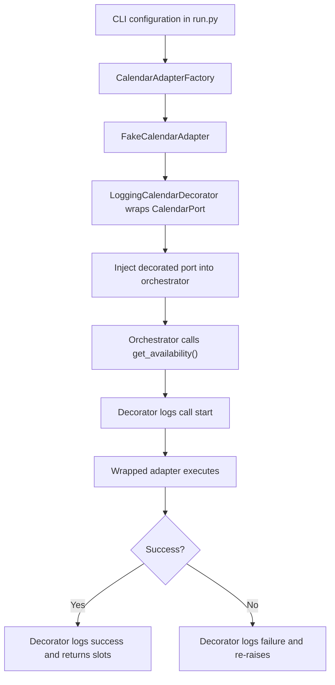

# Week 9 - Factory, Adapter, and Decorator
 
## Pattern 1: Factory
 
**Intent:** move calendar-provider creation out of workflow logic and centralize selection in one place.
 
- **Factory class:** `CalendarAdapterFactory` in `factories/calendar_factory.py`.
- **Input:** `provider_name` (currently `fake`) and `should_fail`.
- **Output:** an object satisfying `CalendarPort`.
- **Caller:** `run.py`, which configures and composes the application.
 
```python
base_calendar = CalendarAdapterFactory.create(
    provider_name=provider_name,
    should_fail=calendar_fails,
)
```
 
A supported provider is constructed explicitly. An unknown provider raises `ValueError` and is handled in `run.py` as a configuration error. The factory currently supports the deterministic fake provider only; adding real providers would need additional adapters and factory branches.
 
## Pattern 2: Adapter
 
**Intent:** translate the application's narrow calendar contract into the behavior of a particular provider.
 
- **Port:** `CalendarPort` in `ports/calendar_port.py`.
- **Adapter:** `FakeCalendarAdapter` in `adapters/fake_calendar.py`.
- **Operation:** `get_availability()` returns a list of available study slots.
- **Failure contract:** the adapter raises `CalendarUnavailableError` when availability cannot be obtained.
 
This fake adapter is an educational stand-in for an external service. It makes the exercise deterministic and does not call a real calendar API.
 
## Pattern 3: Decorator
 
**Intent:** add logging around a calendar operation without changing provider code.
 
- **Decorator class:** `LoggingCalendarDecorator` in `adapters/logging_calendar.py`.
- **Wrapped object:** a `CalendarPort` implementation returned by the factory.
- **Before-call behavior:** print `DECORATOR -> calendar call started`.
- **After-call behavior:** log the number of returned slots.
- **Failure behavior:** log `DECORATOR -> calendar call failed` and re-raise the original exception.
 
```python
calendar = LoggingCalendarDecorator(base_calendar)
```
 
The decorator must preserve the result type and exception behavior expected by the orchestrator. It is not a second independent provider.
 
## How the three patterns work together
 

 
**Reading note:** the first part shows object composition; the second part shows runtime call behavior. The core orchestrator does not choose the concrete provider.
 
## Comparison with direct coupling
 
| Direct approach | Week 9 approach |
|---|---|
| Build `FakeCalendarAdapter` in different callers | One factory centralizes concrete construction |
| Add logging code inside each provider | One decorator wraps any `CalendarPort` |
| Mix provider selection with planning rules | Keep configuration in the composition root |
| Risk hiding exceptions in a wrapper | Explicitly re-raise provider-independent errors |
 
## Observable terminal evidence
 
**Successful calendar call** (selected lines):
 
```text
FACTORY -> created FakeCalendarAdapter
DECORATOR -> calendar call started
FakeCalendarAdapter: get_availability() called
DECORATOR -> calendar call finished with 2 slots
STATE -> Completed
```
 
**Failed calendar call** (selected lines):
 
```text
DECORATOR -> calendar call started
FakeCalendarAdapter: get_availability() called
DECORATOR -> calendar call failed
STATE -> Failed
```
 
**Missing assignments:** the factory can still construct the adapter during startup, but `get_availability()` must not be invoked because validation stops the workflow before tool use.
 
## Design decision
 
For the classroom project, Factory + Adapter + Decorator is sufficient to explain creation, service integration, and cross-cutting behavior. A real provider, retry strategy, or structured logging framework can be added in later iterations, but is not implemented in Week 9.
